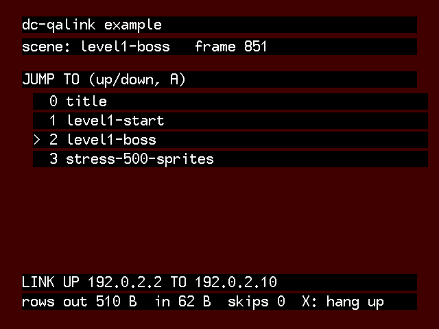
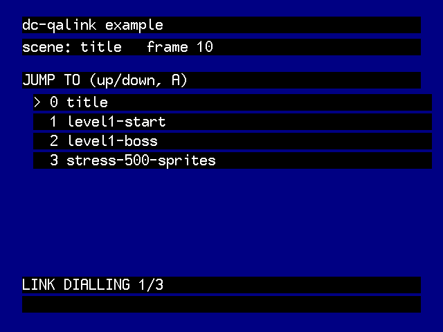
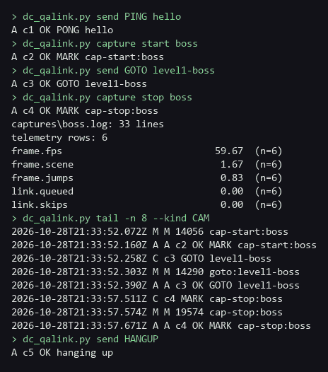

# dc-qalink

A QA and telemetry link for KallistiOS (KOS) Dreamcast programs, over the console's own 56k modem or (0.2) the
broadband adapter.

- **Measure on real hardware:** your program sends `key=value` telemetry once a second; the PC cuts labelled sections
  and averages them.
- **Drive it remotely:** send commands (`PING`, `GOTO level1-boss`, your own) from a PC or a coding agent.
- **Costs nothing on the frame:** the game thread only copies into bounded rings; dialling, PPP and sockets run on
  background threads with static stacks. Off by default at compile time (`DCQL_ENABLE=0`).

<p align="center">
</p>
<p align="center"><sub>Flycast captures of example/ through Flycast's emulated modem: connected after a remote
<code>GOTO level1-boss</code>, and dialling. The addresses on the status line are documentation addresses
(192.0.2.x) drawn over the capture's own in the same font.</sub></p>

## New in 0.2 (branch `v0.2`, not released): the control loop and the broadband adapter

What each claim rests on is marked: **console** (a real Dreamcast), **Flycast** (the emulator, function checks
only), **host** (tests on a PC), **link map** (exact bytes). The full list with dates: `docs/RELEASE_0.2.md`.

- **One link layer, two transports** (`lib/dcql_net.h`): the modem as in 0.1, or the broadband adapter (HIT-0400 or
  the LAN adapter; DHCP or a static address). The 0.1 API is unchanged; `dcql_config_t` gains `net`, `ip`, `mask`,
  `gw` at its end (zero = modem, as before).
- **A loader disc** (`loader/`): boots, brings the link up, and runs programs the PC pushes (deflated, CRC per chunk,
  SHA-256 checked before it runs). `LINK.TXT` on the disc: `net bba|modem`, `host` (the PC, or `peer`: the first PC
  that answers), `port`, `lport`, `number` (modem); the adapter asks DHCP first, and `ip`/`mask`/`gw` are used only
  when no DHCP server answers (`dhcp no`: those alone); `slot` is the loader disc's GDEMU image number, selected
  before every way back so a return lands on the loader and not on openMenu. Its screen shows three large lines you
  can read off a TV: the console's address, the PC it looks for, beacons sent and answers heard. Its HELLO carries the
  adapter's MAC (a PC keeps one console by it across address changes), the GDEMU slot and version, and the stub's
  record of the last way back. **On Flycast, start the bridge (or the app) before Flycast:** Flycast on Windows stops
  receiving on a console port whose beacon met a PC port nobody listened on (an ICMP "port unreachable"), so a bridge
  started after the loader links but its push gets "no answer to LOAD". A real console's KallistiOS ignores that
  ICMP (Flycast found it; a console run of "boot the loader, wait 30 s, then start the bridge" is on the release's
  console checklist).
- **The first run on a console:** `python tools/first_console.py --program build/testprog.elf` waits for the beacon,
  pushes the test program, reads its report, grabs the console's screen 3 times, sends RESET and prints a pass/fail
  table. The PC tool learns the console's address from its beacon (`--udp auto`).
- **The client library** (`loader/client.mk`) in each pushed program: its report and exit code back to the PC, its
  serial lines live, stills (RGB565 frame buffers as PNG on the PC), the PC's files as `/pc/...` (load time; a
  program that wants reads in play counted does it itself), and RESET from the PC.
- **The way back is a full restart** (the default, `LINK.TXT` `return reboot`): every ending (normal exit,
  deadline, exception, `abort`/`assert`, RESET) first sends the run's END (its state and the tail of its report) to
  the PC, then selects the loader's GDEMU image and reboots through the BIOS, so the console comes back to the loader
  without a power cycle. When the PC has gone away, END's retries share a 4 s budget (no new retry starts after it;
  a step under way finishes first, so it is about 4 s, not a hard bound on the whole exit), and a link that is down
  gives up at once (code reading and Flycast; `docs/RELEASE_0.2.md`). A copy of the run's record is also kept for the loader to read after the
  reboot. The quick in-RAM return stub (`return stub`) is **optional and experimental**: on the console (2026-11-22)
  it froze after its jump, and it is not the default until a console run brings it back.
- **The SH-4 watchdog is opt-in** (`wdt=1` in the run's arguments): reset mode, fed by TMU1 every 1 ms. On the
  owner's console (2026-11-22) it measured a 5.22 ms limit and a longest feeding gap of 2.76 ms, and a program hung
  with interrupts off came back by itself (console). Otherwise, last, `pc/power.py` ("power cycle needed", or your
  smart plug; the plug rung is still open).
- **The in-game menu** (`lib/dcql_menu.c`, `docs/MENU.md`, `DCQL_MENU=1`): the link's state, log lines, a QR code
  of a state snapshot and pages the game registers (host pictures and Flycast).
- **The network disc** (`lib/dcql_disc.c`, `docs/NETDISC.md`): a pushed program reads `/cd/...` from the PC over
  the adapter, either changed files over the GDEMU disc or a whole disc (Flycast and host).
- **One PC tool**: `python pc/dc_qalink.py loop status|push|run|report|serve|tail|stills|reset|power|relay-local`
  (`pc/dcql_loop.py`). The protocol and the hand-off area are one versioned header (`include/dcql_loop.h`,
  protocol 2); the loader and the PC tool refuse each other's other versions. `--udp <console>` binds every address
  of this PC: naming a console on the network is the opt-in. The bridge (`pc/qalink_bridge.py`) binds 127.0.0.1 and
  talks only to Flycast unless started with `--allow-lan` (`docs/BRIDGE_API.md`).

```
Dreamcast --broadband adapter/UDP 52060--> PC (dc_qalink.py loop ...)      or, on the modem, via the DreamPi relay
```

`make -C loader OUT=build` builds `loader.elf`, `LOADER.BIN` (put it on the loader disc next to `1ST_READ.BIN`),
`testprog.elf` and the host test build (`make ... host`). Flycast: `[network] EmulateBBA = yes`, run
`dc_qalink.py loop relay-local` before the loader boots, and give `LINK.TXT` an `lport` other than `port`. Stock
desktop Flycast changes the SH-4's interrupt state from its network thread without a lock, so under heavy adapter
traffic an emulated program can panic ("spurious RESET exception") or hang; that is the emulator, not the console.
Keep Flycast runs short, one boot per few steps.

## Hardware

- A Dreamcast with its modem, and a PPP peer on a phone line: a **DreamPi** (Raspberry Pi + USB modem + line
  inducer), or any Linux box with a voice modem and `pppd`.
- A PC on the same network as the Pi. Flycast's modem emulation works for development (no Pi needed).

```
Dreamcast --modem/PPP--> DreamPi (relay, UDP 52040) <--ssh/TCP 52041-- PC (dc_qalink.py)
```

## Setup in 5 steps

1. **Add the library** to your KOS Makefile (see `example/Makefile`):
   `DCQL_DIR := path/lib`, `include $(DCQL_DIR)/dcql.mk`, add `$(DCQL_OBJS)`, `$(DCQL_CFLAGS)`, `$(DCQL_LDFLAGS)`.
   Build QA discs with `make DCQL_ENABLE=1`; retail builds leave it off.
2. **Call it:** `dcql_config()`, `dcql_set_command()`, `dcql_start()` once; `dcql_poll()` every frame;
   `dcql_telemetry("frame fps=60 scene=3\n")` once a second.
3. **Set up the Pi** from the PC: `python relay/pi_setup.py` (finds the Pi, installs a key and the relay service).
   On any other pppd box: `sudo relay/install.sh`.
4. **Dial** from the console (auto at boot, or a menu item). Check: `python pc/dc_qalink.py --ssh dreampi send PING`.
5. **Measure:** `capture start fight`, play, `capture stop` writes `captures/fight.log` and `fight.summary.txt`.

<p align="center"></p>
<p align="center"><sub>PC side of the same Flycast run: PING, a labelled capture around a remote GOTO, the summary
and the marker echoes in the relay log.</sub></p>

Flycast instead of a Pi: run the relay on the PC, set `[network] DCNet = no` in emu.cfg, configure the console with
`cfg.host = "<PC address>"` and `cfg.lport = 52042` (Flycast opens the console's port on the PC). For the example:
`make CFLAGS_EXTRA='-DEX_HOST=\"192.0.2.10\" -DEX_LPORT=52042'`, then load `dcql-example.elf` in Flycast.

## API (`lib/dcql.h`)

| Call | What it does |
|---|---|
| `dcql_config(&cfg)` | Dial number, relay host (or learn the peer), ports, PAP login, `bulk_ok` / `log` hooks |
| `dcql_start()` / `dcql_stop()` | Dial (3 tries) or hang up, in the background; both return at once. `start` after a drop redials |
| `dcql_poll()` | Per frame: runs received commands (built in: `PING`, `MARK`, `STATUS`; others go to your handler) |
| `dcql_set_command(fn, user)` | Your handler: `int fn(id, VERB, args, user)`; return 0 for "unknown" |
| `dcql_telemetry(body)` / `dcql_log(text)` | Queue a T / L row (multipart, split at line ends; skipped, not queued, when backlogged) |
| `dcql_answer(id, ok, fmt, ...)` | Answer a command |
| `dcql_mark(label)` | A marker row, echoed three ways for robust capture cuts |
| `dcql_state()` / `dcql_state_text()` / `dcql_counters()` | For your on-screen status line and telemetry |

## Wire format (UDP, text, one row per datagram, at most 1200 bytes)

| Row | From | Format |
|---|---|---|
| Command | PC | `<id> <VERB> [args]` |
| A answer | console | `A <id> OK\|ERR <text>` |
| T telemetry | console | `T <seq> <ms> <part>/<parts>\n<name k=v k=v ...lines>` |
| L log | console | `L <seq> <part>/<parts>\n<text>` |
| M mark | console | `M <ms> <label>` (plus `A <id> OK MARK <label>` and an L line `dcql-mark: <label>`) |

The relay logs each line as `<UTC time> <kind> <text>` and adds `C` (commands it sent) and `S` (its own state). A
capture cut accepts any echo of a marker (C, M, A or the L line), so one lost datagram never loses a section.

## Limits and footprint

0.2, the control loop's client in a pushed program (link + live data; link map, exact bytes, `docs/SIZES.md`):

| | at most | measured |
|---|---|---|
| code and constant data | 49,152 B | 21,313 B |
| fixed memory (data + bss) | 73,728 B | 70,187 B |
| return stub | 7,168 B | 6,144 B |
| with the in-game menu | (reported) | +10,038 B code, +3,988 B fixed |
| a program with the network disc | (reported, its own program) | 114,627 B fixed (the disc's cache and tables 44,440 B) |

Heap, outside those rows: the client's link thread (16 KiB) and grab thread (8 KiB) stacks while the link runs, the
/pc read-ahead block (8 KiB) while a /pc file is open, and the built-in 4 KiB rings only for a program that supplies
none. Lifetimes: `docs/SIZES.md` "Heap".

0.1, the text-row API on the modem:
- Measured with KOS 2.x (GCC 15.2), example ELF with vs without the link: **+49.0 KB code, +1.0 KB data,
  +31.4 KB BSS** (the library itself: 6.1 KB code, 28 KB BSS; libppp 8.3 KB code). Includes the KOS modem, PPP, UDP
  and socket code it pulls in.
- Threads: dial (8 KiB stack, while dialling), PPP (4 KiB, while connected), modem timer worker (4 KiB). All stacks
  are static. KOS heap: thread records plus a socket, about 2.5 KiB while up; each received datagram is freed on the
  same pass.
- Rings: 4 KiB each way. Telemetry and log rows are admitted only while under 2400 queued bytes (about 0.7 s of line
  at 33.6 kbps), so a slow line never grows the backlog; answers and marks use the rest.
- No IPv4 fragment reassembly (KOS without `net_init()`): every datagram stays under 1200 bytes both ways.
- Hang-up never destroys a thread that may hold libppp's lock; if PPP does not leave in 3.2 s the state is
  `FAILED (-31)` and the next `dcql_start()` retries.
- Uses `--wrap` on three KOS symbols and renames four in libppp; tested against KOS at commit 804b319.

## Agent skills

`skill/` holds four short skills for coding agents (Claude Code and similar): `dc-qalink-integrate` (add the library
to a KOS game), `dc-qalink-pi-setup` (set up the relay on a Pi), `dc-qalink-capture` (measure on hardware) and
`dc-qalink-loop` (0.2: push programs, pull reports and stills, recover hangs).

## Tests

`python3 -m unittest discover -s tests` runs the relay and PC tool against a fake console (loss, reorder, a dropped
start marker) and checks `pi_setup.py`'s discovery parsing, ssh config writing and dry run.
`python3 tests/test_loop.py --host build/cl_host --out <dir>` runs the control loop's own console code (built for the
PC) against the PC tool over a simulated bad line: loss, corruption, a dead line, a restarted sender, damaged images
that must be refused, the protocol-version refusal both ways, the file service and stills. The checks that guard a
fault come with a control that must fail (a damaged image, an old implementation); not every positive case has one.
The gate runs the full `test_loop` (with its modem-rate transfer), `test_assets` with its four controls and
`test_safety` (20 tests, 5 control rows) as rows of their own. `sh lib/test/run.sh` checks the console library's directory-entry and ring-ownership rules with AddressSanitizer, and
with ThreadSanitizer the rings under stop / reconfigure / start with traffic and the /pc read-ahead block under
several readers; each control (the code before the fix) must fail. No game and no console needed.

The PC side is Python 3.10 or newer, standard library only, except: the MCP server needs the Python MCP SDK
(`pip install mcp`), and the asset pipeline (`pc/assets`, the bridge's asset routes and `tests/test_assets.py`) needs
numpy, with Pillow for image formats other than PNG. `THIRD_PARTY.md` names each file that needs a package.

## Licence

MIT (see LICENSE). KallistiOS and libppp are under their own licences (THIRD_PARTY.md). Not affiliated with Sega.
