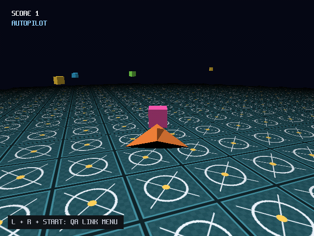

# demo3d: the sample game

A small original 3D game for trying dc-qalink end to end: a low-poly craft glides over a tiled floor collecting floating
cubes, and the score counts them. Everything in it is made here (MIT): the code, the floor tile, the craft model.
The text is the Spleen font dc-qalink already ships.



*Flycast (function check), pushed by the bridge and grabbed over the link.*

What it shows:
- **Push and run**: the bridge pushes `demo3d.elf` to the loader; no SD card change.
- **The network disc**: its one texture (`DEMO3D/FLOOR.BMP`) and one model (`DEMO3D/CRAFT.OBJ`) are read from `/cd`
  at start, never inside a picture. Under the loader on the broadband adapter `/cd` is the network disc first, so a
  file changed on the PC shows on the next push.
- **Live data** every picture: game update, transform and submit, the wait for the graphics chip, the whole picture;
  the score, cubes taken and vertices; the craft's position. Two warp presets (`start`, `corner`) and two options
  (`speed` 1 to 8, `autopilot` 0 or 1).
- **Screen grabs**, **serial lines** (one per cube taken), **pad input from the PC**.
- **The in-game menu** (L + R + START): the Link, Log and Snapshot pages and a **Demo** page with **Crash now** (the
  run comes back crashed, with its report and the registers), **Back to the loader**, a new round, autopilot and speed.

Controls: stick or D-pad left and right to steer, A faster, B slower. With no input for 3 s the autopilot flies to the
nearest cube (the `autopilot` option turns it off).

## Build
With a KallistiOS environment (`source environ.sh`):
```
make -C example/demo3d OUT=build                    # build/demo3d.elf (link, live data, menu, network disc)
make -C example/demo3d OUT=build stage              # build/stage/: demo3d.elf, DEMO3D/, extras/FLOOR_ALT.BMP
make -C example/demo3d OUT=build-off DCQL_ENABLE=0  # the game alone: no network code and no menu
```
The link-off build reads the same files from its own disc, and draws built-in art when they are missing, so it also
runs on a plain disc image of its own.

## Run it in Flycast
Flycast with its broadband adapter on, booted from the loader disc (QA Link Cloud's set-up makes its own Flycast
settings). Then either:
- **QA Link Cloud**: the first-run set-up, "Flycast only", "Start with the sample game", and the first run pushes it; or
- **the bridge** from a dc-qalink checkout, with the staged folder as the one folder it shares:
  ```
  python pc/qalink_bridge.py --files build/stage --overlay build/stage --asset-root build/stage
  ```
  then push `build/stage/demo3d.elf` (`POST /v0/runs`, the MCP's push tool, or `pc/dcql_loop.py run`).

## Run it on a console
The loader on the GDEMU's SD card once (QA Link Cloud's set-up shows how), the console on the broadband adapter on
the same network as the PC (for example the PC at 192.0.2.10 and the console at 192.0.2.40). Start the bridge as
above with `--allow-lan` (QA Link Cloud: Settings, "Dreamcast on the network"), start the loader, push. Over the modem
the program runs but the network disc is skipped (too slow): it draws the files from its own disc or the built-in art.

## Swap the texture
1. Open `DEMO3D/FLOOR.BMP` in the folder the bridge serves (`build/stage`, or QA Link Cloud's sample folder) in any
   paint program, draw on it, save it as a 24-bit BMP (sides a power of two, 8 to 512 pixels). Or copy
   `extras/FLOOR_ALT.BMP` over it (QA Link Cloud's "Swap the floor" does that).
2. RESET and push again. The bridge reads its folder again at each push; the floor on screen is the new one.

The model works the same way: `DEMO3D/CRAFT.OBJ`, a text OBJ (vertices and faces; either winding draws right).

## Files
| File | What |
|---|---|
| `demo3d.c` | the game (about 600 lines) |
| `Makefile` | build, link-off build, stage |
| `make_art.py` | writes the art below (standard library only) |
| `disc/DEMO3D/FLOOR.BMP`, `disc/DEMO3D/CRAFT.OBJ` | the texture and the model |
| `art/FLOOR_ALT.BMP` | the second floor for the swap |
